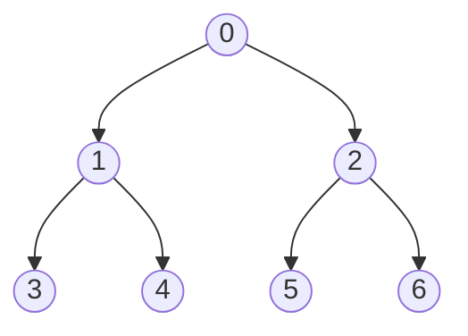

# Tree AllReduce

Distributed training of large neural networks requires aggregating gradients computed independently on each node so that every device ends up with the same global sum. One classical approach is the **Tree AllReduce**: values travel up a binary tree (reduce phase) and are then broadcast back down (broadcast phase) so that every node ends with the global sum.

In this assignment you will implement the missing communication logic inside `tree_worker` (in `student.py`), a function that each simulated node executes as its own process.

---

## Background

### Setup

The tree is fixed and contains exactly $N = 7$ nodes arranged as a complete binary tree:



| Symbol | Meaning |
|---|---|
| `ROOT` | Node 0 (the root) |
| `LEAVES` | Nodes 3, 4, 5, 6 |
| `PARENT_OF[i]` | Parent of node $i$ ($-1$ for root) |
| `CHILDREN_OF[i]` | List of children of node $i$ (empty for leaves) |
| $v_i$ | Initial value at node $i$ |

Each node $i$ starts with a scalar value $v_i \in \mathbb{R}$. After a successful AllReduce every node must hold the global sum

$$
S = \sum_{i=0}^{6} v_i.
$$

### Processes and Queues

The simulation spawns 7 Python processes communicating through `multiprocessing.Queue` objects (analogous to MPI send/recv on real hardware).

| Variable | Direction | Purpose |
|---|---|---|
| `up_send_q` | child → parent | send partial sum upward |
| `up_recv_qs[child]` | child → this | receive partial sum from each child |
| `down_recv_q` | parent → this | receive broadcast value from parent |
| `down_send_qs[child]` | this → child | send broadcast value to each child |

Two helper functions are provided:

- `_send(queue, value)` — puts `value` onto `queue`.
- `_recv(queue)` — blocks until a value is available, then returns it.

---

## Algorithm: Two-Phase Tree AllReduce

### Phase 1 — Reduce (bottom-up)

The goal is for the root to accumulate the complete global sum $S$.

1. **Leaves** send their value $v_i$ upward immediately (no children to wait for).
2. **Internal nodes** (including the root) first receive a value from each child and add it to their running accumulator `val`. After all children have been heard, their `val` equals the sum of the entire subtree rooted at that node.
3. **Non-root** nodes then send their accumulated `val` to their parent.
4. The **root** does not send upward; after receiving from both children it holds $S$.

After Phase 1: node 0 holds $S$; all other nodes hold partial subtree sums.

### Phase 2 — Broadcast (top-down)

The goal is for every node to receive $S$.

1. The **root** already holds $S$; it sends $S$ to each of its children.
2. **Internal nodes** receive $S$ from their parent, overwrite `val` with $S$, then forward $S$ to each of their children.
3. **Leaves** receive $S$ from their parent and overwrite `val`. They have no children so they stop there.

After Phase 2: every node holds $S$.

### Execution Timeline

1. All nodes synchronise at `barrier.wait()` — Phase 1 begins.
2. Each node executes the Reduce phase (receiving from children, then sending to parent, as applicable).
3. All nodes synchronise at a second `barrier.wait()` — Phase 2 begins.
4. Each node executes the Broadcast phase (receiving from parent, then sending to children, as applicable).
5. Each node writes its final `val` into `result_dict[node_id]`.
6. All nodes synchronise at a final `barrier.wait()` before exiting.

---

## Task

### Task Description

Open `student.py` and complete the `# TODO` blocks inside `tree_worker`.

### Constraints

- Do not modify any code outside the four `# TODO` blocks.
- Do not add new queues or processes.
- Use only the provided `_send` and `_recv` helpers for all inter-node communication.
- The tree topology is fixed at $N = 7$ nodes; you do not need to handle arbitrary tree shapes.

---

## Testing

The `run_tree_all_reduce` function at the bottom of the file acts as the correctness checker. It initialises random scalar values, runs the multi-process simulation, and verifies that every node's final value equals the expected global sum. Run the tests with:

```bash
python3 student.py
```
